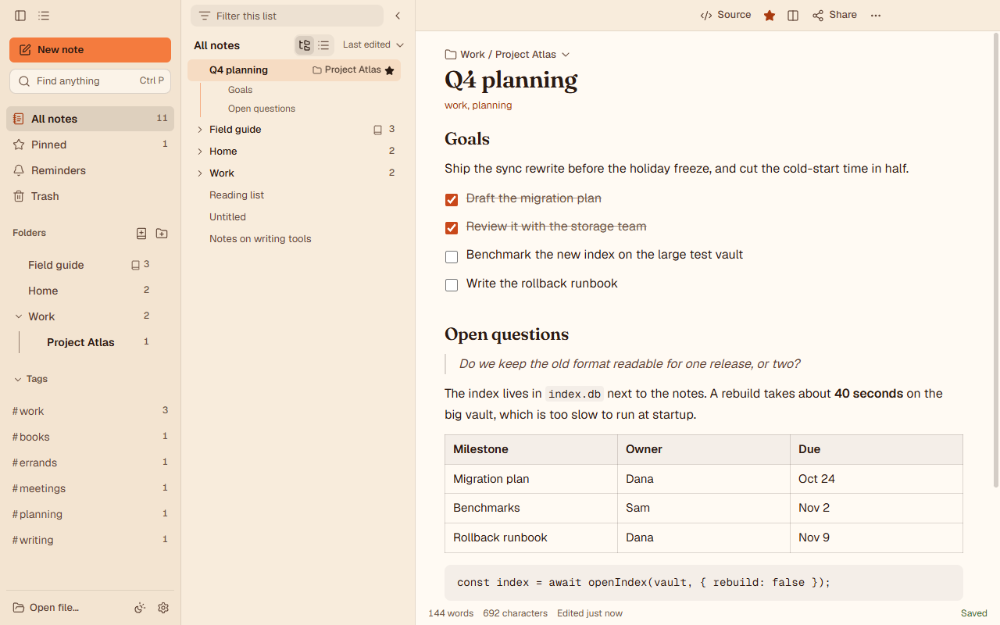
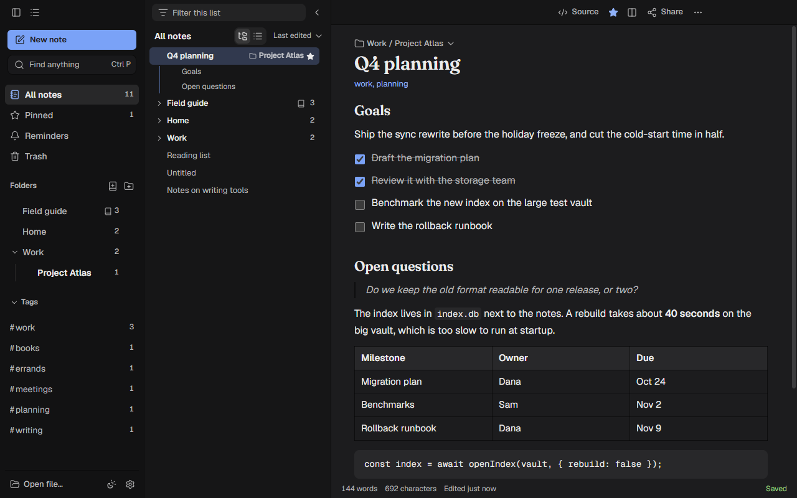
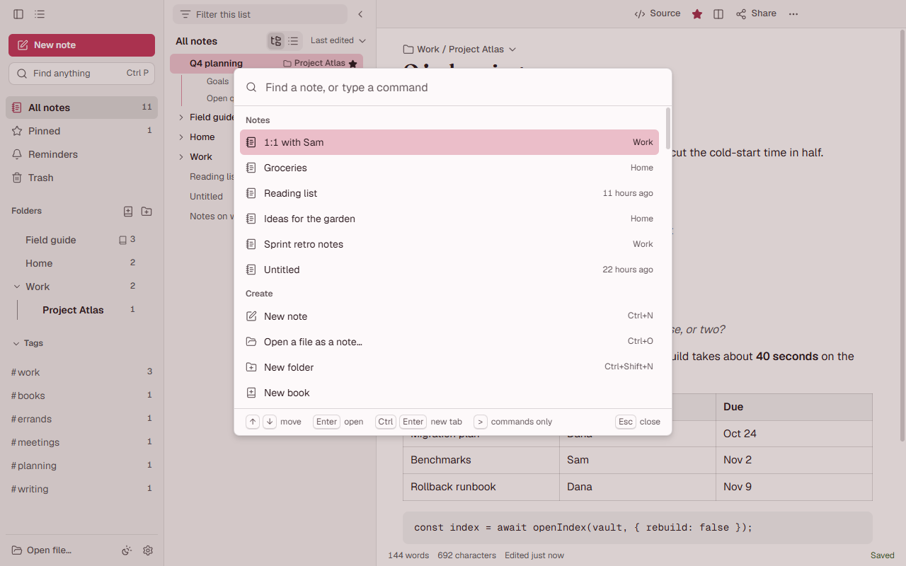

# Notes

A notes app for Windows that opens from anywhere with **Ctrl+Alt+N**. It keeps your notes, Markdown files, Word documents, PDFs and code files in one place. Everything stays on your computer, and syncing goes through a git repository you own, not a cloud account.



**Status:** in development. Notes runs on Windows 10 and 11, from source. Installers and a macOS version are planned.

## Contents
- [Install and run](#install-and-run)
- [What it does](#what-it-does)
- [Files it opens](#files-it-opens)
- [Vaults and git sync](#vaults-and-git-sync)
- [Claude Code panel](#claude-code-panel)
- [Keyboard shortcuts](#keyboard-shortcuts)
- [Where your data lives](#where-your-data-lives)
- [Development](#development)
- [Licence](#licence)

## Install and run

You need Windows, [Node.js](https://nodejs.org) 24 with npm (the version Notes is developed with), and [git](https://git-scm.com). Notes uses git for each note's version history and for vault sync.

```
git clone https://github.com/celestinryf/notes-desktop.git
cd notes-desktop
npm install
npm start
```

`npm run install:shortcuts` adds Notes to the Start Menu and the desktop and starts it.

- **The hotkey:** Ctrl+Alt+N shows or hides Notes from any app, and Esc hides it. If another app already holds Ctrl+Alt+N, Notes takes Ctrl+Shift+Alt+N, Ctrl+Alt+J or Ctrl+Alt+F12 and says which one in Settings. You can change it in Settings (Ctrl+,).
- **The tray:** closing the window hides Notes; the tray icon shows it again, starts a new note or sticky note, and quits.
- **Start at sign-in:** on by default, so the hotkey always works. Turn it off in Settings › General ("Start Notes when I sign in") or in the tray menu ("Start at login").

## What it does

**Writing**
- Markdown renders as you type: `## ` makes a heading, `- [ ] ` a checklist, `**bold**` bold. Tables, images and code blocks render too. Ctrl+E shows the Markdown source, and Markdown is what gets saved.
- Type `/` for a menu of blocks (headings, lists, checklist, quote, code, table, divider, today's date, a link to a note). Type `[[` to link to another note, or to create one and link it.
- If a note holds Markdown the rendered view cannot show faithfully, it opens as source with a notice, so just opening a note never rewrites it.
- Spelling suggestions are in the right-click menu.

**Finding and organising**
- **Command palette (Ctrl+P):** one box finds any note by title or text and runs every command, each listed with its shortcut. Type `>` to see commands only.
- **Search (Ctrl+F)** filters the list by title, text and tags, with matches highlighted.
- **Folders** nest as deep as you like. Drag notes and folders to move them. The note list shows folders with their notes inside, or one flat list (the switch is beside the sort menu).
- **Tags**, a **Pinned** view, a **Reminders** view and a **Trash** with Undo, restore, delete forever and empty trash.
- **Pinned notes stay on top.** In All notes, every pinned note comes first, wherever it lives. In a folder, that folder's pinned notes come first.
- **Sort** by last edited, newest or title.
- **Tabs and split view:** Ctrl+click opens a note in a new tab, and Split view puts a second side next to the first.
- **Books:** turn a folder into a book whose notes are pages in a set order, with page tabs, a reading view of the whole book, and export to one Markdown, HTML or PDF file. "Split into a book…" turns a long note into a book, one page per heading.
- **Related notes:** under each note, the notes it links to, the notes that link to it, and notes that share its tags.

**Each note**
- **Earlier versions (Ctrl+Shift+H):** Notes' own notes are saved to a local git history a few seconds after each change (on by default, in Settings › History). Preview an old version and restore it. Locked notes are left out.
- **Lock (Ctrl+L):** encrypts the note's text on disk with a password (scrypt and AES-256-GCM). The title stays visible. A forgotten password cannot be recovered.
- **Reminders (Ctrl+Shift+M):** a Windows notification when it is due.
- **Stick to the desktop (Ctrl+Shift+T):** the note becomes a small window on the desktop, with a colour, and edits flow both ways.
- **Attach files (Ctrl+Shift+O)** and **record a voice memo (Ctrl+Shift+G):** files are copied into Notes' own folder and linked from the note.
- **Read aloud (Ctrl+Shift+R)** with the system's voices, and **dictate (Ctrl+Shift+D)** through Windows speech recognition.
- **Share (Ctrl+Shift+S):** copy as Markdown, rich text or plain text, copy a link to the note, email it, or save it as PDF, HTML or Markdown.
- **Live share:** edit one note together with people on your local network, with no account or outside service. It is plain HTTP, and the random token in the link is its only protection: anyone on the network who has the link can edit the note until you stop sharing.
- **Print (Ctrl+Shift+P)**, duplicate, and export as Markdown.

**Appearance**
- Light and dark themes, following Windows by default (Ctrl+Shift+L switches). Colour schemes: Notes, Paper, Slate, Forest, Ocean, Rose, Sepia, or your own background, text and accent colours.
- Text size, a full-width or narrower writing column, always on top, and resizable panes.
- Hide the sidebar (Ctrl+\\) or the note list (Ctrl+Shift+\\). A hidden sidebar slides in when the pointer reaches the left edge.



## Files it opens

Open a file with Ctrl+O, **Open file…** at the bottom left, or by dropping it on the window. It becomes a note that edits the file itself, in its own format. Changes made by other programs show up while the note is open.

| Files | How they open |
|---|---|
| Markdown (`.md`) | The rendered editor, saved back as Markdown |
| Plain text (`.txt`) | A plain text box |
| LaTeX, code and config (`.tex`, `.py`, `.js`, `.json` and dozens more) | A code editor with highlighting and line numbers |
| `.csv`, `.tsv` | A table; Ctrl+E edits the text |
| Images (`.png`, `.jpg`, `.gif`, `.webp`, `.bmp`, `.ico`, `.avif`) | A viewer, fitted to the pane or at actual size |
| PDF | A viewer where you can highlight, add text, draw, sign, comment, fill forms and reorder pages. The original is backed up before each save |
| Word (`.docx`) | A simple editor for text, bold, italic and underline, with the document's layout |
| Spreadsheets (`.xlsx`, `.xls`, `.ods` and others) | Through GridCraft (below); otherwise "Open with…" opens them in their own app |

- **Convert to…** saves a copy in another format (Markdown, text, HTML, Word or PDF) next to the original, and never overwrites a file. Copies made from a PDF or a spreadsheet keep only the text.
- Any other text file up to 4 MB opens as text.
- **Open with…** opens the file in its usual app.
- **WordCraft and GridCraft (optional):** Notes can host two web apps built from Rust: [WordCraft](https://github.com/celestinryf/wordcraft), a full word processor for the Word family, and [GridCraft](https://github.com/celestinryf/gridcraft), a spreadsheet. Notes looks for their web builds in `%USERPROFILE%\wordcraft\dist\web` and `%USERPROFILE%\gridcraft\dist\web`, or in the folders named by `NOTES_APP_WORDCRAFT_DIR` and `NOTES_APP_GRIDCRAFT_DIR`.
- **MarkItDown (optional):** with Microsoft's [MarkItDown](https://github.com/microsoft/markitdown) installed (`pip install "markitdown[all]"`), search also finds the text inside `.xlsx` and `.xls` files.



## Vaults and git sync

A vault is a folder of Markdown and text files that Notes shows as notes, in the same way as Obsidian. Add one in Settings › Vaults, either an existing folder or a git repository to clone.
- Subfolders become folders.
- A new note becomes a file named after its title. Renaming a note renames the file, moving it moves the file, and trash moves it to the vault's `.trash` folder.
- Changes made outside Notes, by another editor or by `git pull`, appear on their own.

For a vault that is a git repository with a remote, Notes syncs the way obsidian-git does. It commits 8 seconds after the last change, pulls with rebase, and pushes. It also syncs every few minutes (5 by default), and when Notes quits if a change is still waiting. Notes never resolves a conflict for you: the sync stops, your commit stays, and the vault's status says what happened. The folder keeps working in Obsidian or any other editor.

Notes' own notes have their history in a local git repository that tracks the notes folder. Settings › History can push it to a remote you choose, as a backup.

## Claude Code panel

Ctrl+Shift+A opens a panel that runs [Claude Code](https://github.com/anthropics/claude-code) on your notes and shows its output as it works.
- **Where it runs:** for one of Notes' own notes, or with no note open, Claude Code works in the notes folder; for a vault note, in the vault folder; for a file, in the file's folder. Its edits are the files themselves, so they show up as soon as it finishes.
- **What it may do:** with "Allow edits" off, a panel run can only read. "Open terminal" starts an ordinary interactive Claude Code session in the same folder, which that switch does not limit.
- **What it needs:** the `claude` command on your PATH, signed in with a Claude account. Notes refuses to run it when it is set up to bill API credits.

Settings › Agent files › **Add my agent files** links your coding agents' files (such as `CLAUDE.md`, `AGENTS.md`, and Claude Code's commands, output styles and memory) into an "Agent files" folder, where editing a note edits the real file.

## Keyboard shortcuts

| Keys | Action |
|---|---|
| Ctrl+Alt+N | Show or hide Notes from anywhere (changeable in Settings) |
| Esc | Hide Notes (closes a menu or dialog first) |
| Ctrl+P | Command palette: any note or command |
| Ctrl+N | New note |
| Ctrl+O | Open a file as a note |
| Ctrl+Shift+N | New folder |
| Ctrl+F | Search all notes |
| Ctrl+Shift+F | Find in this note (Enter, Shift+Enter or F3 to step) |
| Ctrl+H | Find and replace |
| Ctrl+E | Markdown source or rendered view |
| Ctrl+D | Pin or unpin |
| Ctrl+S | Save now |
| Ctrl+B, Ctrl+I, Ctrl+K | Bold, italic, link |
| Ctrl+Shift+S | Share menu |
| Ctrl+Shift+H | Earlier versions |
| Ctrl+Shift+M | Remind me |
| Ctrl+L | Lock |
| Ctrl+Shift+O | Attach files |
| Ctrl+Shift+G | Record a voice memo |
| Ctrl+Shift+R | Read aloud |
| Ctrl+Shift+D | Dictate |
| Ctrl+Shift+T | Stick to the desktop |
| Ctrl+Shift+P | Print |
| Ctrl+Shift+A | Claude Code panel |
| Ctrl+Shift+Del | Move to trash (Ctrl+Del also works outside a text field) |
| Alt+↑, Alt+↓ | Previous or next note |
| Ctrl+T, Ctrl+W | New tab, close tab |
| Ctrl+Tab, Ctrl+Shift+Tab | Next or previous tab |
| Ctrl+PageDown, Ctrl+PageUp | Next or previous page of a book |
| Ctrl+\\, Ctrl+Shift+\\ | Hide or show the sidebar, the note list |
| Ctrl+Shift+L | Light or dark |
| Ctrl+=, Ctrl+-, Ctrl+0 | Zoom in, out, reset |
| Ctrl+, | Settings |

## Where your data lives

Notes has no account and sends nothing anywhere on its own. It uses the network only when you ask it to:
- pushing to and pulling from git remotes you set up;
- a live share on your local network;
- images in a note that point to a web address;
- the Claude Code panel, which runs your own `claude` command.

Your notes are Markdown files in the notes folder, `Documents\Notes` (or `Notes 2` and so on if that name is taken by something else). Each folder in Notes is a folder on disk, a note's tags are in its front matter, and a locked note is an encrypted `.mdlock` file with no readable text in it. Any editor or AI tool can read and change these files while Notes is open; Notes picks up the changes. "Show the notes folder" in the command palette opens it.

The rest is in `%APPDATA%\notes-app\` (the tray's "Open data folder" opens it):

| Path | What it holds |
|---|---|
| `notes.json` | Settings, and what Notes remembers about each note on this computer: where its file is, pins, stickies, reminders, open tabs, and a copy of its text so Notes starts quickly. The files are the real notes; this is rebuilt from them |
| `notes.journal` | The changes saved since `notes.json` was last written, one line each. Notes folds them into `notes.json` when the journal grows, ten minutes after the last fold, and when it quits |
| `backups\` | A copy of `notes.json` at most every 10 minutes; the newest 10 are kept |
| `history\` | The git repository behind Earlier versions |
| `attachments\` | Attached files and voice memos |
| `before-files-<date>\` | A copy of `notes.json` from before Notes moved your notes into the notes folder, kept in case you need to go back |

Files you open and vault files stay where they are; Notes only remembers where they are. Settings › Your data exports every note as JSON and imports Markdown files.

## Development

```
npm run typecheck   # tsc over the main process and the renderer
npm test            # unit tests
npm run test:ui     # drives the real app with Playwright, in a separate data folder
npm run test:e2e    # presses the real hotkey with SendKeys: hands off the keyboard while it runs
npm run test:all    # all four
npm run shots       # screenshots of the app's screens, with sample notes
```

- **The main process** is TypeScript (`src/*.mts`), which Electron runs directly by stripping the types, with no build step.
- **The page** is TypeScript too (`src/renderer/`), bundled with esbuild into `src/renderer/vendor/`. Run `npm run build:app` after changing it; a unit test fails while the bundle is stale. `npm run build` rebuilds every bundle, including the editors.
- **Notices:** `npm run notices` regenerates `THIRD_PARTY_NOTICES.txt` after a dependency change.

Issues and pull requests are welcome; run `npm run test:all` before opening one. Please report security problems privately, through the repository's Security tab.

## Licence

MIT, see [LICENSE](LICENSE). Third-party code and fonts are listed in [THIRD_PARTY_NOTICES.txt](THIRD_PARTY_NOTICES.txt).
